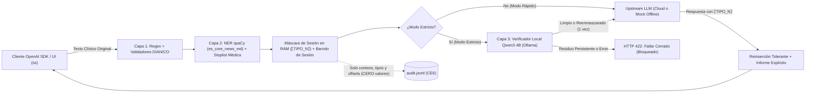

# Tapaito — Proxy Local de Privacidad para IA Clínica en Colombia

[](./LICENSE)
[](./pyproject.toml)
[](./src/tapaito/api/routes_openai.py)

> **Aviso de alcance:** Tapaito **reduce la exposición de datos personales** enviados a modelos de lenguaje externos mediante enmascarado reversible por sesión y verificación local open-weight. Ningún detector automático es infalible ni sustituye una evaluación jurídica o clínica humana. Consulta [`docs/LIMITS.md`](./docs/LIMITS.md).

---

## 1. El Problema

En hospitales, IPS, consultorios y oficinas jurídicas de salud en Colombia, profesionales redactan historias clínicas, epicrisis, órdenes médicas y tutelas apoyándose en modelos de lenguaje en la nube. Al copiar y pegar texto clínico sin un filtro local previo, suelen quedar expuestos identificadores colombianos directos y contextuales:

- **Cédulas de ciudadanía (CC)** con o sin puntos (`1.032.456.789`).
- **NIT de aseguradoras (EPS), IPS y clínicas** con dígito de verificación (DV) módulo 11 de la DIAN (`800.251.440-6`).
- **Radicados judiciales de tutela en salud** de 23 dígitos de la Rama Judicial (`11001-31-03-001-2024-00123-00`).
- **Teléfonos móviles (`+57 3XX...`), fijos, direcciones urbanas colombianas (`Calle/Carrera/Diagonal/Transversal # -`) y correos.**
- **Nombres de pacientes, acompañantes y médicos tratantes**, incluso escritos en minúsculas o tras abreviaturas clínicas.

Las herramientas genéricas en inglés suelen fallar ante formatos locales (como el DV DIAN del NIT o los 23 dígitos de un radicado judicial) o sobre-enmascaran términos médicos críticos (como códigos `CUPS`, `CIE-10`, dosis o fármacos del POS/PBS), degradando la respuesta del modelo.

---

## 2. Arquitectura en 3 Capas + Reinserción Tolerante

Tapaito actúa como un **proxy HTTP local (`127.0.0.1:8000`) compatible con la API de OpenAI** (`POST /v1/chat/completions`, `GET /v1/models`). Todo el preprocesamiento ocurre en la máquina del usuario antes de que un solo byte salga hacia el proveedor configurado.



### ¿Por qué Enfoque 1 con `qwen3:4b` local?
El modelo open-weight **no** reemplaza al LLM en la nube que redacta el resumen clínico; actúa como **auditor de privacidad local (Capa 3)** sobre el texto ya enmascarado por las Capas 1 y 2. De este modo:
1. El documento original jamás abandona `127.0.0.1`.
2. `qwen3:4b` (corriendo en Ollama con `think: false` y ventana acotada para caber en GPUs de **4 GB de VRAM**) inspecciona el texto enmascarado buscando residuos sutiles (nombres en minúsculas sin etiqueta estándar) y alerta sobre **cuasi-identificadores contextuales** (p. ej. `"único juez promiscuo municipal de Puerto Carreño"`).
3. El upstream (`TAPAITO_UPSTREAM_BASE_URL`) puede apuntar a cualquier servidor compatible con OpenAI (OpenAI, vLLM/Ollama con Gemma 4, LiteLLM o el modo `mock` incluido por defecto para pruebas offline).

---

## 3. Instalación y Demo en ≤ 5 Comandos (CE7 / CE8)

Requisitos previos: Python 3.11+ y (para el modo `estricto` con verificador LLM local) [Ollama](https://ollama.com/) con `qwen3:4b`. La demo funciona **100 % sin conexión a internet** gracias al upstream mock integrado.

```powershell
# 1. Crear entorno virtual e instalar Tapaito + modelo spaCy es_core_news_md
python -m venv .venv; .\.venv\Scripts\pip install -e ".[dev]"; .\.venv\Scripts\python -m spacy download es_core_news_md

# 2. (Opcional para Modo Estricto en vivo) Descargar y precalentar Qwen3 4B en Ollama
ollama pull qwen3:4b

# 3. Ejecutar la suite de pruebas (98 tests unitarios, E2E y de seguridad CE1-CE6)
.\.venv\Scripts\python -m pytest -q

# 4. Ejecutar la demo interactiva de 90s por consola (100% offline) o el benchmark PII-CO
.\.venv\Scripts\python scripts/run_demo_offline.py

# 5. Levantar el servidor local y abrir http://127.0.0.1:8000/ui en el navegador
.\.venv\Scripts\uvicorn tapaito.api.app:app --host 127.0.0.1 --port 8000
```

*(Si dispones de GNU `make`, equivalen a: `make setup`, `make pull-model`, `make test`, `make bench` y `make demo`).*

---

## 4. Uso desde cualquier Cliente OpenAI (CE1)

Cualquier aplicación existente que use el SDK oficial de `openai` funciona cambiando únicamente `base_url`:

```python
from openai import OpenAI

client = OpenAI(
    base_url="http://127.0.0.1:8000/v1",
    api_key="no-requerida-en-modo-mock",
    default_headers={
        "X-Tapaito-Mode": "rapido",          # "rapido" (Capas 1-2) o "estricto" (Capas 1-3, falla cerrado)
        "X-Tapaito-Session": "consulta-001", # Mantiene coherencia de tokens ⟦PERSONA_1⟧ en la conversación
    },
)

resp = client.chat.completions.create(
    model="tapaito-mock",
    messages=[
        {"role": "system", "content": "Resume la historia clínica conservando diagnósticos y dosis."},
        {
            "role": "user",
            "content": (
                "Paciente Juan Carlos Restrepo Gómez con CC 1.032.456.789, afiliado a EPS Sanitas "
                "(NIT 800.251.440-6), cel +57 314 567 8901. Diagnóstico CIE-10 J189, CUPS 890201, "
                "Losartán 50 mg cada 12h."
            ),
        },
    ],
)

print(resp.choices[0].message.content)
```

---

## 5. Resultados del Benchmark Sintético PII-CO (`test` split — 50 casos, 278 entidades)

El benchmark **PII-CO** ([`bench/data/test/dataset.jsonl`](./bench/data/test/dataset.jsonl), semilla fija `SEED_TEST=202602`, SHA-256 congelado en [`bench/data/test/sha256.txt`](./bench/data/test/sha256.txt)) contiene 50 documentos clínicos y de tutela en salud sintéticos (50 % de casos difíciles con formatos sin etiqueta estándar, nombres en minúsculas, números médicos distractores `CUPS`/`CIE-10`/dosis y cuasi-identificadores). Todos los ajustes de reglas se realizaron exclusivamente sobre el split `dev` (`30` casos).

### 5.1 Comparativa de las 3 Configuraciones

| Configuración | Precisión | Recall Global | F1 Global | Recall Estructurado (CE2) | Fugas Residuales (CE3) | Tasa Reinserción (CE4) | Latencia p50 (ms) | Latencia p95 (ms) |
| :--- | :---: | :---: | :---: | :---: | :---: | :---: | :---: | :---: |
| **A. Solo Regex + Validadores** (`regex_only`) | 1.0000 | 0.6115 | 0.7589 | 1.0000 | 38.85% (108/278) | 100.00% | 0.86 | 1.52 |
| **B. Modo Rápido: Regex + NER** (`rapido_regex_ner`) | 0.9888 | 0.9496 | 0.9688 | **1.0000** | 4.32% (12/278) | 100.00% | 12.23 | 19.23 |
| **C. Modo Estricto: Regex + NER + Qwen3 4B** (`estricto_qwen`) | 0.9684 | **0.9928** | **0.9805** | **1.0000** | **0.00% (0/278)** | 100.00% | 3893.86 | 7963.12 |

### 5.2 Desglose por Tipo de Entidad en `test`

| Tipo de Entidad | Gold (`test`) | Recall Config A (`regex_only`) | Recall Config B (`rapido`) | Recall Config C (`estricto_qwen`) | Precisión Config B |
| :--- | :---: | :---: | :---: | :---: | :---: |
| `CEDULA` | 62 | 1.0000 | **1.0000** | **1.0000** | 1.0000 |
| `NIT` (con DV DIAN) | 50 | 1.0000 | **1.0000** | **1.0000** | 1.0000 |
| `CELULAR` | 15 | 1.0000 | **1.0000** | **1.0000** | 1.0000 |
| `TELEFONO_FIJO` | 14 | 1.0000 | **1.0000** | **1.0000** | 1.0000 |
| `CORREO` | 11 | 1.0000 | **1.0000** | **1.0000** | 1.0000 |
| `DIRECCION` | 7 | 1.0000 | **1.0000** | **1.0000** | 1.0000 |
| `RADICADO` (23 dígitos) | 11 | 1.0000 | **1.0000** | **1.0000** | 1.0000 |
| `PERSONA` | 58 | 0.0000 | 0.7586 | **0.9655** *(+12 recuperados como `RESIDUO` → 100% cubiertos)* | 0.9565 |
| `UBICACION` | 35 | 0.0000 | **1.0000** | **1.0000** | 0.9722 |
| `ORGANIZACION` | 15 | 0.0000 | **1.0000** | **1.0000** | 1.0000 |

- **Explicación de resultados:**
  - **CE2 (Recall Estructurado ≥ 0.95):** La Capa 1 alcanza `1.0000` en `CEDULA`, `NIT`, `CELULAR`, `CORREO` y `RADICADO` con `0` falsos positivos sobre códigos médicos `CUPS`, `CIE-10` o dosis en mg/ml.
  - **CE3 (Reducción de fugas por Capa 3):** En el Modo Rápido (`rapido_regex_ner`), las 12 fugas residuales (`4.32 %`) corresponden a casos difíciles donde el nombre de un contacto o acompañante fue escrito deliberadamente en minúsculas y sin etiqueta clínica estándar (p. ej. `"en caso de urgencia avisar en recepción a luz marina betancur"`). Al activar el Modo Estricto (`estricto_qwen`), `qwen3:4b` detecta esos 12 casos como residuos y los reenmascara antes de salir, reduciendo las fugas residuales de entidades a **0.00 % (`0/278`)**.
  - **CE4 (Utilidad y Reinserción ≥ 95 %):** En [`bench/results/utility_results.json`](./bench/results/utility_results.json) (`12` casos de resumen clínico), la tasa media de reinserción es **100.0 %** y la preservación de códigos diagnósticos CIE-10 y medicamentos en la respuesta reinsertada es **100.0 %**.

---

## 6. Documentación Adicional del Repositorio

- [`docs/DEMO.md`](./docs/DEMO.md): Guion cronometrado de 90 segundos para la demostración en vivo y offline.
- [`docs/LIMITS.md`](./docs/LIMITS.md): Límites técnicos conocidos, riesgos residuales y marco de uso responsable.
- [`docs/COMPARISON.md`](./docs/COMPARISON.md): Comparativa verificada frente a Microsoft Presidio, LLM Guard y LiteLLM.
- [`docs/DECISIONS.md`](./docs/DECISIONS.md): Registro de decisiones de arquitectura y resultados del spike de Qwen3 4B en 4 GB de VRAM.
- [`docs/RISKS.md`](./docs/RISKS.md): Matriz completa de 17 riesgos (R1–R17) con evidencia empírica de mitigación.
- [`docs/FUTURE.md`](./docs/FUTURE.md): Hoja de ruta post-MVP (streaming SSE, OCR/PDF, voz, dominio legal/financiero).

---

## 7. Licencia

Distribuido bajo la licencia **Apache 2.0**. Consulta [`LICENSE`](./LICENSE) para más detalles.
